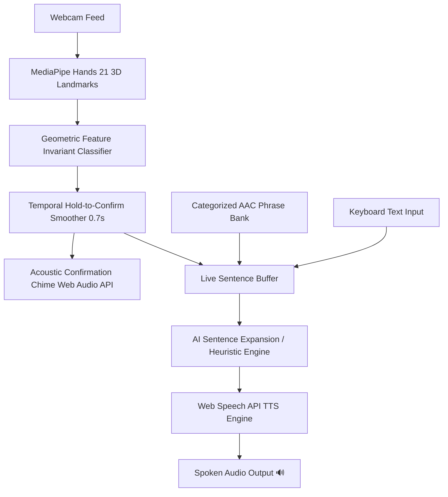

# 🌐 VoiceBridge — AI Real-Time Sign & Speech Communication Platform

> **Empowering non-verbal individuals to speak freely using edge AI computer vision, gesture intelligence, and accessible Text-to-Speech.**

---

## 💡 Problem & Impact Framing
Over **250+ million people worldwide** live with severe speech disabilities caused by conditions such as **laryngectomy, ALS (Amyotrophic Lateral Sclerosis), stroke-induced aphasia, cerebral palsy, and non-verbal autism**. 

Dedicated AAC (Augmentative and Alternative Communication) hardware devices often cost between **$3,000 to $10,000+**, requiring proprietary insurance approvals and bulky specialized hardware. 

**VoiceBridge** solves this by providing a **zero-cost, client-side, browser-native platform** that works on any standard laptop, tablet, or smartphone equipped with a webcam.

---

## 🚀 Key Features

1. **Real-Time Client-Side Sign Language Recognition**:
   - Uses **MediaPipe Hands** running at 30+ FPS directly on the client (WebGL/WASM acceleration).
   - Real-time 21 3D landmark geometric classification invariant to distance and scale.
   - **Hold-to-Confirm Stabilization** (0.7s temporal buffer) with circular HUD feedback to eliminate false positives.

2. **Web Speech API & Audio Synthesis**:
   - Zero-latency, free, offline-capable text-to-speech engine.
   - **4 Customizable Voice Profiles**:
     - 🌟 *Natural Voice* (Standard pitch & cadence)
     - 🧘 *Calm & Gentle* (Relaxed conversational rate)
     - 📢 *Clear & Slow* (High-articulation for noisy environments)
     - 🚨 *Urgent & Alert* (Elevated pitch/volume for emergencies)
   - Real-time synthesized harmonic chimes via **Web Audio API** on confirmed gestures.

3. **Intelligent AAC (Augmentative & Alternative Communication) Board**:
   - Categorized high-contrast quick-phrase bank:
     - 🚨 *Emergency & Medical* ("I need immediate help", "I am in severe pain", "Call doctor")
     - 💧 *Daily Needs* ("I need water", "I need food", "Bathroom", "Tired")
     - 👋 *Social & Greetings* ("Hello", "Thank you", "Yes", "No", "I love you")
     - ❓ *Questions & Clarifications* ("Where is it?", "What time is it?")
   - 1-Tap instant speech & 1-Tap sentence buffer accumulation.
   - User-defined **Custom Phrases** with local persistent storage.

4. **AI Sentence Expansion & Smoothing Engine**:
   - Transforms terse keyword sequences (`WATER` + `PAIN` + `HELP`) into grammatically natural spoken sentences (`"I need some water and I am in severe pain. Please help me."`).

5. **Judge Diagnostic & Virtual Simulation Mode**:
   - Built-in interactive gesture simulator allowing judges and testers without a physical webcam to test the full ML-to-Speech pipeline instantly.
   - Live telemetry showing FPS, landmark tracking confidence, and active joint states.

---

## 🛠️ Architecture & Tech Stack



- **Frontend**: Accessible HTML5, CSS3 Custom Properties Design System (High Contrast Cybernetic Theme), Vanilla ES6+ Modules.
- **Machine Learning**: MediaPipe Hands (Google Research) via WebGL/WASM.
- **Speech Engine**: Browser Web Speech API (`SpeechSynthesisUtterance`).
- **Audio Feedback**: Browser Web Audio API (`AudioContext`, `OscillatorNode`, `GainNode`).
- **Persistence**: Browser `localStorage` (Zero login friction).

---

## 🏃 Getting Started & Local Run

### Quick Run (No Install Required):
Simply open `voicebridge/index.html` in any modern web browser (Google Chrome, Microsoft Edge, Brave, Safari, Firefox).

### Run with Local Development Server:
```bash
# Using Python
python -m http.server 8000

# Or using Node.js / npx
npx serve .
```
Navigate to `http://localhost:8000/voicebridge/` in your browser.

---

## 📊 Supported Gestures Reference

| Gesture | Sign / Hand Shape | Function / Meaning |
| :--- | :--- | :--- |
| 👋 **Hello / Stop** | Open 5-finger palm | Greeting / Pause |
| 👍 **Help / Good** | Thumbs Up fist | Request assistance / Confirm OK |
| 👎 **No / Disagree** | Thumbs Down fist | Refusal / Disagree |
| ✊ **Yes / Agree** | Closed compact fist | Affirmation / Agree |
| 💧 **Water** | ASL "W" (Index, Middle, Ring up) | Request water / hydration |
| 🍲 **Food / Eat** | Pinched 5-fingertip cluster | Request meals / snacks |
| ☝️ **Pain** | Single Index finger pointing up | Alert pain or discomfort |
| ✌️ **Peace / Two** | ASL "V" / Peace sign | Peace / Number 2 |
| 👌 **OK** | Thumb & Index circle | All good / Comfortable |
| 🤟 **I Love You** | Thumb + Index + Pinky (ASL ILY) | Affection / Care |
| 🙏 **Thank You** | Flat 4 fingers together | Gratitude / Please |
| 🚻 **Bathroom** | ASL "I" (Pinky extended) | Restroom assistance |
| 🤙 **Call Doctor** | ASL "Y" (Thumb + Pinky extended) | Summon doctor / phone call |

---

## ⚖️ Hackathon Judging Alignment

| Judging Criteria | Implementation in VoiceBridge |
| :--- | :--- |
| **Impact** | Directly addresses assistive communication for 250M+ non-verbal individuals, replacing $5,000+ hardware with a free browser app. |
| **Feasibility** | Runs 100% on-device with zero server latency, zero cloud costs, and no user accounts required. |
| **User Experience** | Single-screen accessible layout, hold-to-confirm progress rings, audio chimes, AAC speed grid, and high contrast visibility. |
| **Technical Craft** | MediaPipe 3D landmark geometry, temporal stabilization algorithms, Web Audio synthesis, and dynamic speech modulation. |

---

## 📄 License
MIT License — Free and open for assistive and educational purposes.
